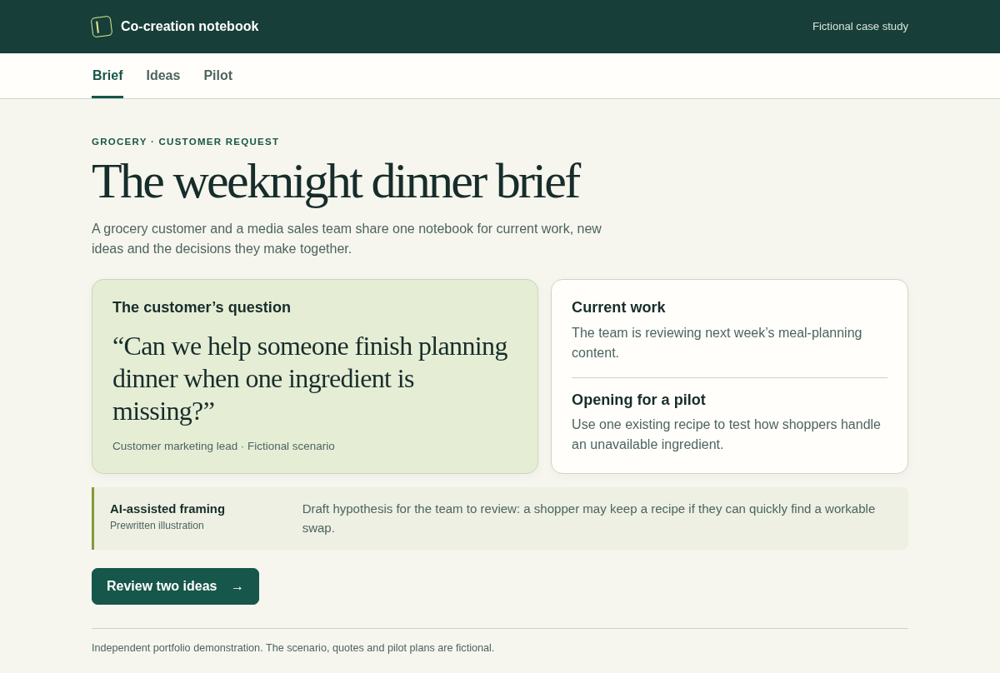
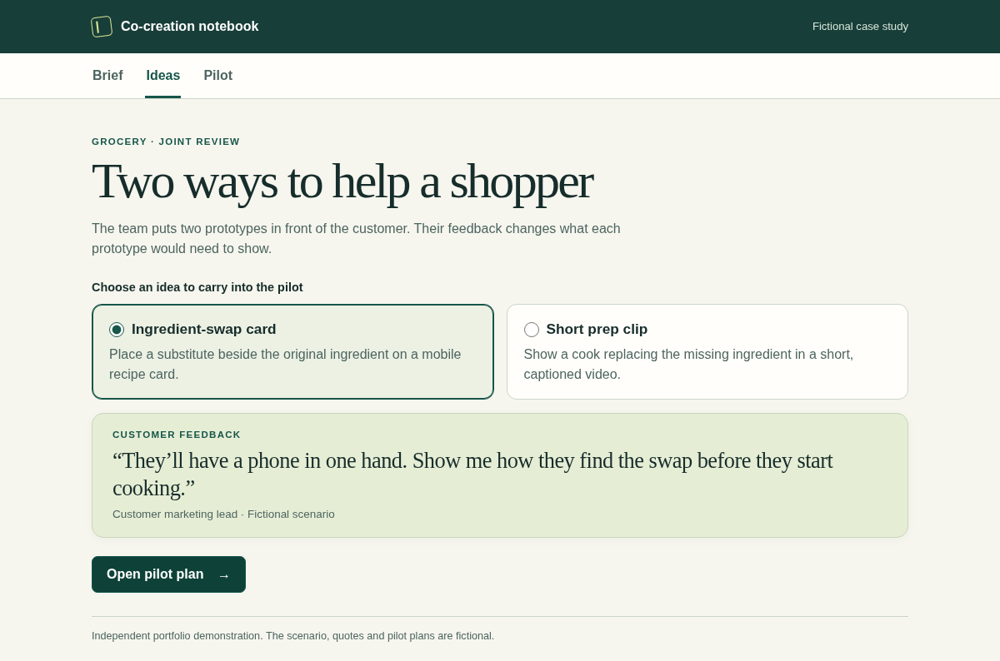
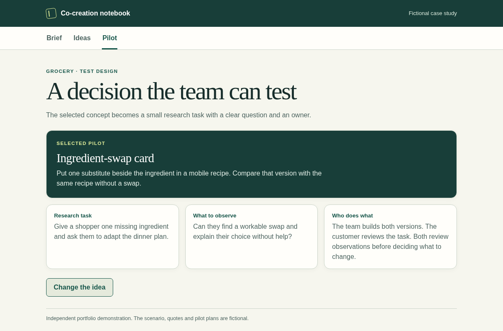

# From customer brief to shared pilot

A fictional grocery customer asks what happens to a dinner plan when an ingredient is missing. A media sales team and the customer use a shared workspace to develop two ideas and agree on a small test.

**My role.** I lead commercial teams that build solutions with customers. In a real customer collaboration, our team built a shared space for day-to-day account work and new ideas. This independent example shows how I encourage teams to invite the customer into the first prototype review, while it is still easy to change.

**[Open the interactive demo](https://fernandofcnunes.github.io/customer-co-creation/)**

To explore it offline, download [index.html](index.html) and open it in a browser. Choose either idea to see how the research question changes. It runs locally with no sign-in, dependencies or network requests. The walkthrough below can be read directly on GitHub.

### 1. Frame the customer’s request

A routine review of meal-planning content surfaces a practical question. A prewritten illustration of AI-assisted framing turns it into a hypothesis for people to review. The demo does not call an AI service.

### 2. Let feedback change the prototype

The team proposes an ingredient-swap card and a short prep clip. The customer asks how a shopper holding a phone in one hand will find the alternative before cooking.

### 3. Choose the next test together

For the card, compare the same recipe with and without a visible substitute. For the clip, compare when the substitute appears. The team builds the variants, the customer reviews the task, and both review observations before deciding what to change.

The scenario, quotes and test plans are fictional. The planned tests have no reported results.
