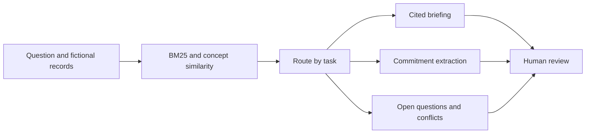

# From scattered notes to a decision brief

A portfolio case inspired by my work on a personal executive copilot. The operating problem is familiar to managers: a launch decision is approaching, but the relevant evidence sits in several documents. The briefing should identify the commitments, show where each claim comes from, and surface decisions still open.

## Try the case

[Open the interactive demo](https://fernandofcnunes.github.io/customer-co-creation/cases/executive-copilot/)

A fictional city is evaluating an equipment collection pilot through libraries and community centers. Make the launch decision from the records in each scenario.

- **Sufficient evidence.** Read the recommendation and follow the citations behind its conditions.
- **Missing evidence.** Identify which decision inputs still need confirmation.
- **Conflicting evidence.** Compare the source records before treating a disputed date as a commitment.

Change the question to explore the routing. For example, ask *“Who owns the launch follow-ups and when are they due?”* or *“Which open questions should we raise before launch?”* Use the method trace to inspect the selected route and the reference panel to read each cited document.

## Design

Two retrieval signals combine exact-term relevance and similarity across a small set of domain concepts. The question selects an extractive briefing, a structured commitment pass, or a review of open questions. The output preserves source identifiers and flags unresolved differences before the reader relies on them.

The demo is a deterministic, browser-based illustration. Its retrieval and routing are implemented in JavaScript and run locally against a fully fictional corpus. The public case uses original code and synthetic records.

## Run locally

Serve this folder over HTTP with `python3 -m http.server 8000` and open `http://localhost:8000`. The demo has no runtime dependencies or API keys.

Run the checks with `node --test engine.test.mjs`.
